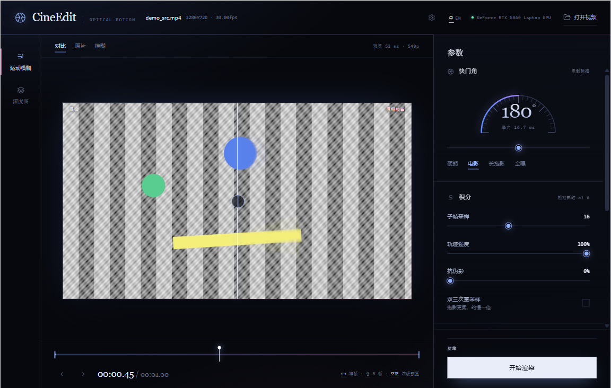

# CineEdit

[中文](README.md) | **English**

**Physically based video motion blur using optical flow and a real shutter model.**

CineEdit does not stretch the image along a fixed direction. It reconstructs
multiple subframes with RAFT optical flow inside a virtual shutter interval,
then integrates them in linear light. It is designed for game recordings,
animation, composited shots, and ordinary video that should look more like it
was captured with a slow camera shutter.



## Features

- Physical shutter model: supports shutter angles from 0 to 360 degrees instead
  of a fixed-direction Gaussian smear.
- RAFT dense optical flow: supports `raft_large` and `raft_small`, including
  half-resolution estimation, guided-filter upsampling, and early convergence.
- Linear-light integration: composites in linear light after sRGB decoding to
  avoid dark or clipped highlights in the blur.
- Robust mode: optional bidirectional flow, forward-backward consistency, and
  photometric consistency weighting.
- Interactive preview: scrub the timeline to inspect the current frame in
  compare, original, and blurred views.
- Two workspaces: switch between motion blur and depth maps in the left rail,
  with independent parameters and output paths.
- Video depth maps: use the local Video Depth Anything Small streaming model
  with offline processing.
- Output controls: preserve input frame rate and audio, with H.264/H.265,
  NVENC, and CRF options.
- Multiple entry points: desktop window, local web UI, CLI, and a packaged
  Windows application.
- Bilingual UI: the desktop build supports the Windows file picker and keyboard
  shortcuts.

## How It Works

A real camera integrates light over the exposure time `T`:

```text
I_out(x) = (1/T) * integral(0..T, I(x, t) dt)
```

CineEdit discretizes the shutter interval into subframes, resamples pixels to
each time using optical flow between neighboring frames, and then averages them
in linear light. For displacement `F` from the current frame `cur` to the next
frame `next`, a material point at time `tau` satisfies:

```text
position in cur  = x - tau * F
position in next = x + (1 - tau) * F
position in prev = x - (1 + tau) * F
```

The full pipeline:

1. Decode video frames with FFmpeg.
2. Estimate dense optical flow between neighboring frames with RAFT.
3. Sample multiple subframes inside the shutter interval.
4. Integrate exposure in linear light.
5. Re-encode with FFmpeg and copy or transcode the audio track.

The core implementation is in [`cinedit/blur.py`](cinedit/blur.py) and
[`cinedit/flow.py`](cinedit/flow.py).

## Requirements

- Windows 10/11. Windows 11 is the primary development and test environment.
- Python 3.10 or newer. The project is currently tested mainly on Python 3.13.
- An NVIDIA CUDA GPU is recommended. CPU rendering works but is significantly
  slower.
- `ffmpeg.exe` and `ffprobe.exe` must be available through `PATH`, the project
  `assets/ffmpeg/` directory, or a matching directory next to the application.
- Depth-map mode requires OpenCV, Einops, and EasyDict. The video depth model is
  loaded from `assets/weights/video_depth_anything_vits/`.
- The desktop window prefers WebView2. If it is unavailable, the app falls back
  to Edge app mode or the browser.

The source checkout does not include `.venv`, `dist`, installers, FFmpeg
binaries, or test videos. On first use, torchvision usually downloads the RAFT
weights. Depth-model weights must be prepared locally as described below. The
application does not download depth models during preview or rendering.

## Installation

```powershell
git clone https://github.com/<your-name>/<your-repo>.git
cd <your-repo>

py -3.13 -m venv .venv
.\.venv\Scripts\Activate.ps1
python -m pip install --upgrade pip
python -m pip install -r requirements.txt
```

If PowerShell blocks activation scripts, invoke the virtual environment
interpreter directly:

```powershell
.\.venv\Scripts\python.exe -m pip install -r requirements.txt
```

`requirements.txt` uses the PyTorch CUDA 12.8 index for NVIDIA GPUs and drivers
that support CUDA 12.8. For other environments, follow the official PyTorch
instructions and adjust the `torch` and `torchvision` versions.

### Install the Depth Model

Depth-map mode uses Video Depth Anything Small:

```text
assets/weights/video_depth_anything_vits/
  video_depth_anything_vits.pth
```

The application loads the model only from this directory and uses local weights.
It does not access Hugging Face during preview or rendering. If the model is
missing, depth-map mode reports an error.

### Install FFmpeg

Prepare a Windows FFmpeg build containing both `ffmpeg.exe` and `ffprobe.exe`,
then choose one of these options:

1. Add the `bin` directory to `PATH`.
2. Put both executables in the project `assets/ffmpeg/` directory.
3. Put both executables in a `ffmpeg/` directory next to the final application.

The fallback bundled with `imageio-ffmpeg` usually includes only `ffmpeg`, not
`ffprobe`, so a complete FFmpeg build is still recommended for full
functionality.

## Usage

### Desktop

```powershell
.\.venv\Scripts\python.exe -m cinedit.app
```

You can also double-click `启动 CineEdit.bat` in the project root. The launcher
prefers the project `.venv` and falls back to system Python if necessary.

In the preview area, press `Space` to start or pause continuous preview. Each
step advances by one source frame. Full rendering starts only from the
`Start Render` button in the lower-right corner.

The gear button opens settings for preview resolution, preview quality, looping,
compute device, output preservation, opening the output directory after
rendering, and keyboard-shortcut hints. Changes take effect immediately and are
saved locally.

### Local Web UI

```powershell
.\.venv\Scripts\python.exe -m cinedit.webui --no-browser --port 8848
```

Then open `http://127.0.0.1:8848`.

### Depth Map Mode

Select `Depth Map` in the left rail to enter the depth workspace. Switching
workspaces does not reload the source video. The timeline position, trim range,
and motion-blur parameters are preserved. The depth workspace exposes quality,
output resolution, depth inversion, and encoder settings. Switching back to
motion blur restores its independent settings.

The default depth output is the source name with `_depth.mp4`, an 8-bit
grayscale video where nearer surfaces are brighter and farther surfaces are
darker. It has no audio track, and its frame rate and trim range match the
source. The model is loaded from
`assets/weights/video_depth_anything_vits/`; preview and rendering do not
download weights.

Existing outputs are preserved by default. Rendering the same source again
uses `_2.mp4`, `_3.mp4`, and so on. This behavior can be disabled in settings.

Prefer an unblurred source for depth maps. If the selected source is a generated
`_blur.mp4`, the UI warns you to use the original clip because motion blur can
amplify colored effects and screen overlays and cause depth errors.

Full depth rendering uses the streaming temporal state of Video Depth Anything.
The engine processes one frame at a time and does not load the entire video into
memory. The output is still relative monocular depth, not measured absolute
distance.

### CLI

```powershell
.\.venv\Scripts\python.exe -m cinedit input.mp4 -o output.mp4 --angle 180
```

Show all options:

```powershell
.\.venv\Scripts\python.exe -m cinedit --help
```

## Common Options

| Option | Default | Description |
| --- | --- | --- |
| `--angle` | `180` | Shutter angle. 90 is crisp, 180 is close to the film standard, and 360 is a full-frame exposure. |
| `--samples` | `16` | Number of subframe samples inside the shutter interval. |
| `--strength` | `1.0` | Scales the motion trail, capped at one frame of exposure. |
| `--flow-model` | `raft_large` | `raft_large` or `raft_small`. |
| `--flow-scale` | `0.5` | Optical-flow computation scale. |
| `--flow-iters` | `8` | Maximum RAFT iterations. |
| `--robust` | Off | Bidirectional flow and consistency suppression. More stable but slower. |
| `--bicubic` | Off | Bicubic resampling for softer trails, roughly twice as slow. |
| `--codec` | `auto` | `h264_nvenc`, `hevc_nvenc`, `libx264`, `libx265`, and others. |
| `--crf` | `16` | Output quality. Lower values produce higher quality. |
| `--trim START END` | None | Process only the specified time range. |
| `--preview HEIGHT` | None | Generate a fast preview at the specified height. |

The UI provides four quality presets:

| Preset | Flow model | Scale | Iteration cap | Use case |
| --- | --- | --- | --- | --- |
| Turbo | `raft_small` | `0.4` | `4` | Long clips and quick look development |
| Fast | `raft_small` | `0.5` | `6` | Most footage |
| Standard | `raft_large` | `0.5` | `8` | Default |
| Fine | `raft_large` | `0.7` | `12` | Short shots and large motion |

## Performance

The following measurements were taken locally on an **RTX 5060 Laptop GPU with
8 GB of VRAM**. Results vary with footage, resolution, sample count, driver, and
encoder:

| Input | Subframe samples | End-to-end speed |
| --- | ---: | ---: |
| 1080p | 12 | About 5.21 fps |
| 1080p | 16 | About 4.79 fps |
| 720p | 16 | About 12 to 18 fps |

Performance analysis is in [`tools/tradeoff.py`](tools/tradeoff.py), and quality
evaluation is in [`tools/evaluate.py`](tools/evaluate.py).

Depth-map measurements used an RTX 5060 Laptop GPU, 392 input size, and 1080p
test video:

| Item | Result |
| --- | ---: |
| Video Depth Anything Small streaming, 1080p, 392 input | About 8.1 fps |

Actual speed varies with footage, encoder, driver, and VRAM state. See
[`docs/depth-benchmark.md`](docs/depth-benchmark.md) for the full environment
and measurement method.

## Known Limitations

1. Background pixels hidden by moving objects cannot be fully reconstructed.
   The default gather sampling cannot invent colors from other moments behind
   the occluder.
2. Solid-color or textureless objects may underestimate motion speed, making
   the trail shorter than the real motion.
3. Shutter angles above 360 degrees have no physical meaning. Increase the
   input frame rate if longer trails are required.
4. On 8 GB of VRAM, 1080p with `--flow-scale 1.0` may run out of memory.
5. The video depth engine cannot recover geometry the model does not recognize.
   Extreme occlusion, large screen overlays, and rapid state changes may produce
   local errors.
6. Full rendering is not real time. Initial model loading and long videos
   require additional time.
7. Depth maps are relative monocular depth, not directly measurable absolute
   distance. The inversion switch only swaps the black and white mapping.

## Project Structure

```text
cinedit/
  cinedit/
    blur.py       Shutter integration and subframe compositing
    flow.py       RAFT optical flow, feature cache, and early exit
    imageops.py   Color space, resampling, guided filtering, and blue noise
    video_depth_engine.py  Video Depth Anything streaming inference
    video_depth_anything/  Vendored video depth model code
    depth_pipeline.py  Depth-map video rendering
    media.py      FFmpeg probing, decoding, and encoding
    pipeline.py   Decode, flow, integration, and encode pipeline
    preview.py    Single-frame preview and caches
    webui.py      Local HTTP service and job scheduling
    app.py        Desktop entry point
    ui.html       Desktop and browser UI
  tools/          Quality evaluation and performance scripts
  tests/          Unit tests
  installer/      Inno Setup packaging scripts
```

## Testing

```powershell
.\.venv\Scripts\python.exe -m unittest discover -s tests -v
```

The tests do not require a full video render. They cover parameter mapping,
preview decoding, file selection, broken-connection handling, and the
zero-shutter fast path.

Offline model validation uses local weights and an offline-startup check to
verify that the model comes from the project model directory. This is not an
operating-system-level network isolation test. The final installer should still
be tested once on a target machine with networking disabled.

## Packaging

The project uses PyInstaller to build a Windows directory application:

```powershell
python -m pip install pyinstaller
python -m PyInstaller CineEdit.spec --noconfirm --clean
```

The output is written to `dist/CineEdit/`. Installer scripts are in `installer/`.
Build outputs should not be committed to Git. Before packaging, prepare
`assets/weights/video_depth_anything_vits/`; `CineEdit.spec` includes the model
directory, VDA code, and dependencies in the application directory. The current
onedir build measures about 4.8 GiB. The installer, compressed with
`lzma2/ultra64` and solid compression, comes out at about 1.92 GiB
(2,063,639,181 bytes), under GitHub’s 2 GiB per-asset limit, so it can be uploaded
as a single Release asset. The headroom is only about 80 MiB: once the payload
grows, trim the CUDA runtime or switch to split volumes, and re-check the
installer size before publishing.

See [`THIRD_PARTY_NOTICES.md`](THIRD_PARTY_NOTICES.md) for the GPLv3 obligations
of the bundled FFmpeg build.

## License

CineEdit source code is released under the [MIT License](LICENSE).

Third-party components, model weights, and the bundled FFmpeg build remain under
their own licenses. See [`THIRD_PARTY_NOTICES.md`](THIRD_PARTY_NOTICES.md).

## Acknowledgements

- [PyTorch](https://pytorch.org/) and
  [torchvision](https://github.com/pytorch/vision) provide the RAFT
  implementation and model entry point.
- [RAFT](https://github.com/princeton-vl/RAFT) provides the optical-flow model
  foundation.
- [FFmpeg](https://ffmpeg.org/) handles video decoding, encoding, and audio
  processing.
- [pywebview](https://pywebview.flowrl.com/) provides desktop WebView
  integration.
