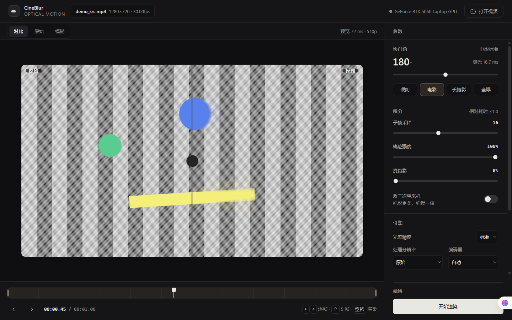

# CineBlur

**基于光流和真实快门模型的视频运动模糊工具。**

CineBlur 不是把画面沿固定方向拉长，而是在虚拟快门区间内使用 RAFT 光流重建多个
子帧，再在线性光空间完成曝光积分。它适合给游戏录像、动画、合成镜头和普通视频
增加更接近真实相机慢快门拍摄的运动模糊。



## 功能

- 物理快门模型：支持 0° 到 360° 快门角，而不是固定方向的高斯拖影。
- RAFT 稠密光流：支持 `raft_large` 和 `raft_small`，包含半分辨率计算、引导滤波
  上采样和收敛提前退出。
- 线性光积分：在 sRGB 解码后的线性光空间合成，避免亮部拖影明显偏暗或过曝。
- 稳健模式：可选双向光流、前后向一致性和光度一致性权重。
- 交互预览：拖动时间轴即可查看当前帧，支持原片、模糊和对比三种视图。
- 双工作模式：左侧模式栏可在运动模糊与深度图之间切换，并分别保留两套参数和输出路径。
- 单目深度图：使用本地 Depth Anything V2 Small 模型，支持三档推理精度和离线处理。
- 常用输出选项：保留输入帧率和音轨，可选择 H.264/H.265、NVENC 和 CRF。
- 多种入口：桌面窗口、本地 Web UI、命令行和打包后的 Windows 程序。
- 中英双语界面：桌面版支持 Windows 文件选择器和键盘快捷键。

## 工作原理

真实相机在曝光时间 `T` 内对连续光强积分：

```text
I_out(x) = (1/T) * integral(0..T, I(x, t) dt)
```

CineBlur 把快门区间离散成多个子帧，用相邻帧的光流把像素重采样到每个时刻，
然后在线性光空间加权平均。对于中心帧 `cur` 到下一帧 `next` 的位移 `F`，
材质点在时刻 `tau` 的位置满足：

```text
position in cur  = x - tau * F
position in next = x + (1 - tau) * F
position in prev = x - (1 + tau) * F
```

完整流程：

1. 使用 FFmpeg 解码视频帧。
2. 使用 RAFT 估计相邻帧的稠密光流。
3. 在快门区间内采样多个子帧。
4. 在线性光空间完成曝光积分。
5. 使用 FFmpeg 重新编码视频并复制或转码音轨。

核心实现见 [`cineblur/blur.py`](cineblur/blur.py) 和
[`cineblur/flow.py`](cineblur/flow.py)。

## 环境要求

- Windows 10/11，Windows 11 为主要开发和测试环境。
- Python 3.10 或更高版本，当前主要在 Python 3.13 上测试。
- 推荐 NVIDIA CUDA GPU；CPU 也可运行，但完整视频渲染会明显更慢。
- `ffmpeg.exe` 和 `ffprobe.exe` 必须位于 `PATH`、项目 `assets/ffmpeg/` 或程序
  旁边的对应目录。
- 深度图模式需要 `transformers==4.57.1`，并从项目内的
  `assets/weights/depth_anything_v2_small/` 加载 Depth Anything V2 Small。
- 桌面窗口优先使用 WebView2；缺失时程序会尝试回退到 Edge 应用模式或浏览器。

源码仓库不包含 `.venv`、`dist`、安装包、FFmpeg 二进制、RAFT 权重和测试视频。
首次运行时 torchvision 通常会下载所需的 RAFT 权重。Depth Anything V2 Small 权重也不会
从仓库自动下载，使用深度图模式前需要按下方说明准备本地模型目录。

## 安装

```powershell
git clone https://github.com/<your-name>/<your-repo>.git
cd <your-repo>

py -3.13 -m venv .venv
.\.venv\Scripts\Activate.ps1
python -m pip install --upgrade pip
python -m pip install -r requirements.txt
```

如果 PowerShell 禁止执行激活脚本，也可以直接调用虚拟环境中的解释器：

```powershell
.\.venv\Scripts\python.exe -m pip install -r requirements.txt
```

`requirements.txt` 使用 PyTorch CUDA 12.8 索引，适合支持 CUDA 12.8 的 NVIDIA
显卡和驱动。其他环境请根据 PyTorch 官方安装说明调整 `torch` 和 `torchvision`
版本。

### 安装深度模型

把 Depth Anything V2 Small 的 Transformers 格式文件放到：

```text
assets/weights/depth_anything_v2_small/
  config.json
  model.safetensors
  preprocessor_config.json
```

程序只从该目录加载模型，并使用 `local_files_only=True` 禁止预览或渲染时访问
Hugging Face。缺少模型文件时深度图模式会直接报错，不会自动下载。

### 安装 FFmpeg

准备一个同时包含 `ffmpeg.exe` 和 `ffprobe.exe` 的 Windows 构建，并任选一种方式：

1. 把 `bin` 目录加入 `PATH`。
2. 把两个程序放到项目的 `assets/ffmpeg/`。
3. 把两个程序放到最终可执行文件旁边的 `ffmpeg/` 目录。

`imageio-ffmpeg` 自带的回退通常只有 `ffmpeg`，没有 `ffprobe`，因此完整功能仍建议
安装完整构建。

## 使用

### 桌面窗口

```powershell
.\.venv\Scripts\python.exe -m cineblur.app
```

也可以双击项目根目录的 `启动 CineBlur.bat`。脚本会优先使用项目 `.venv`，找不到时
再尝试系统 Python。
预览区按 `空格` 可开始或暂停连续预览，每次只前进一个源帧；完整渲染只通过右下角的
“开始渲染”按钮启动。

顶部齿轮按钮打开设置面板，可调整预览分辨率、预览质量、循环预览、计算设备、
是否保留历史产物、渲染完成后是否自动打开输出目录，以及是否显示快捷键提示。
设置即时生效并保存在本机。

### 本地 Web UI

```powershell
.\.venv\Scripts\python.exe -m cineblur.webui --no-browser --port 8848
```

然后打开 `http://127.0.0.1:8848`。

### 深度图模式

在界面最左侧选择“深度图”即可进入单目深度图工作区。切换模式不会重新载入素材，
当前时间轴位置、裁剪区间以及运动模糊参数都会保留。深度图模式提供质量档位、输出
分辨率、深度反转和编码器设置；再次切回“运动模糊”时，两套参数仍各自独立。

深度图默认输出为源文件名加 `_depth.mp4`，画面为 8-bit 灰度，近处更亮、远处更暗，
不包含音轨，帧率和裁剪区间与源视频一致。模型从项目内的
`assets/weights/depth_anything_v2_small/` 加载，正常预览和渲染不会联网下载权重。
默认会保留历史产物，重复渲染同一素材时自动改用 `_2.mp4`、`_3.mp4` 等递增名称；
可在设置中关闭这一行为。
深度图应优先使用未模糊的原片；如果载入的是程序生成的 `_blur.mp4`，界面会提示改用
原片，因为运动模糊会放大彩色技能特效和屏幕叠加层，容易造成深度误判。
完整渲染默认启用“时域稳定”：静态区域会与上一帧深度做运动感知融合，减少复杂视频
中的频闪；快速相机运动或大面积场景切换会自动保留当前帧，避免拖影。静态背景
区域的实测帧间差由 5.95/255 降至 1.36/255，约减少 77%。

### 命令行

```powershell
.\.venv\Scripts\python.exe -m cineblur input.mp4 -o output.mp4 --angle 180
```

查看全部参数：

```powershell
.\.venv\Scripts\python.exe -m cineblur --help
```

## 常用参数

| 参数 | 默认值 | 说明 |
| --- | --- | --- |
| `--angle` | `180` | 快门角。90° 更硬朗，180° 接近电影标准，360° 为整帧曝光 |
| `--samples` | `16` | 快门区间内的子帧采样数 |
| `--strength` | `1.0` | 轨迹长度缩放，上限为一帧曝光 |
| `--flow-model` | `raft_large` | `raft_large` 或 `raft_small` |
| `--flow-scale` | `0.5` | 光流计算分辨率比例 |
| `--flow-iters` | `8` | RAFT 迭代上限 |
| `--robust` | 关闭 | 双向光流和一致性抑制，质量更稳但更慢 |
| `--bicubic` | 关闭 | 双三次重采样，拖影更柔和，约慢一倍 |
| `--codec` | `auto` | `h264_nvenc`、`hevc_nvenc`、`libx264`、`libx265` 等 |
| `--crf` | `16` | 输出质量，数值越低画质越高 |
| `--trim START END` | 无 | 只处理指定时间区间 |
| `--preview HEIGHT` | 无 | 按指定高度生成快速预览 |

界面提供四个质量档位：

| 档位 | 光流模型 | 比例 | 迭代上限 | 适用场景 |
| --- | --- | --- | --- | --- |
| 极速 | `raft_small` | `0.4` | `4` | 长片粗剪、快速看效果 |
| 快速 | `raft_small` | `0.5` | `6` | 大部分素材 |
| 标准 | `raft_large` | `0.5` | `8` | 默认 |
| 精细 | `raft_large` | `0.7` | `12` | 短镜头、大位移 |

## 性能

以下数据来自项目作者在 **RTX 5060 Laptop GPU、8 GB 显存** 上的本地测试，
会随视频内容、分辨率、采样数、驱动和编码器变化：

| 输入 | 子帧采样 | 端到端速度 |
| --- | ---: | ---: |
| 1080p | 12 | 约 5.21 fps |
| 1080p | 16 | 约 4.79 fps |
| 720p | 16 | 约 12 到 18 fps |

性能分析脚本位于 [`tools/tradeoff.py`](tools/tradeoff.py)，质量评估脚本位于
[`tools/evaluate.py`](tools/evaluate.py)。

深度图模式的本地实测使用 Depth Anything V2 Small、默认 Fast 档位（392 输入边长）
和 RTX 5060 Laptop GPU，测试视频为 1080p、30 fps、90 帧：

| 项目 | 实测结果 |
| --- | ---: |
| 模型加载 | 0.532 s |
| 720p 完整渲染（含解码和编码） | 15.08 fps |
| 1080p 完整渲染（含解码和编码） | 10.33 fps |

完整渲染使用 90 帧测试片段；实际速度会随素材、编码器、驱动和显存状态变化。
此前 Turbo/336 实测为 720p 17.76 fps、1080p 11.07 fps。Fast 较慢但没有硬失败，
因此继续作为已批准默认档位。完整环境和测量方法见
[`docs/depth-benchmark.md`](docs/depth-benchmark.md)。

## 已知限制

1. 被运动物体遮挡的背景无法完整回填。默认的 gather 采样无法凭空获得遮挡区域
   在其他时刻的颜色。
2. 纯色或无纹理物体可能低估运动速度，拖影会比真实运动偏短。
3. 快门角超过 360° 没有物理意义；需要更长拖影时应先提高输入帧率。
4. 8 GB 显存下，1080p 配合 `--flow-scale 1.0` 可能显存不足。
5. 深度图默认启用静态区域时域融合；快速相机运动、大面积遮挡或场景切换区域仍按当前帧处理，可能出现轻微闪烁。
6. 完整渲染不是实时效果，首次模型加载和长视频处理都需要额外时间。
7. 深度图是相对单目深度，不是可直接测量的绝对距离；反转开关只交换黑白映射。

## 项目结构

```text
cineblur/
  cineblur/
    blur.py       快门积分与子帧合成
    flow.py       RAFT 光流、特征缓存和收敛提前退出
    imageops.py   颜色空间、重采样、引导滤波和蓝噪声
    depth_engine.py  Depth Anything V2 推理
    depth_pipeline.py 深度图视频渲染
    media.py      FFmpeg 探测、解码和编码
    pipeline.py   解码、光流、积分、编码流水线
    preview.py    单帧预览和缓存
    webui.py      本地 HTTP 服务和任务调度
    app.py        桌面窗口入口
    ui.html       桌面和浏览器界面
  tools/          质量评估和性能测试脚本
  tests/          单元测试
  installer/      Inno Setup 打包脚本
```

## 测试

```powershell
.\.venv\Scripts\python.exe -m unittest discover -s tests -v
```

测试不需要完整视频渲染，主要覆盖参数映射、预览解码、文件选择、错误连接处理和
零快门快速路径。

离线模型验证使用 `HF_HUB_OFFLINE=1`、`TRANSFORMERS_OFFLINE=1` 和
`local_files_only=True`，证明模型来自 Hugging Face 本地缓存或项目模型目录；
这不是操作系统级断网隔离。完整安装包仍需在目标机器上做一次实际断网验收。

## 打包

项目使用 PyInstaller 生成 Windows 目录版程序：

```powershell
python -m pip install pyinstaller
python -m PyInstaller CineBlur.spec --noconfirm --clean
```

生成结果位于 `dist/CineBlur/`。安装包生成脚本位于 `installer/`，构建产物不应提交
到 Git 仓库。打包前必须准备好 `assets/weights/depth_anything_v2_small/`；
`CineBlur.spec` 会把模型目录和 `transformers` 的数据、二进制及隐藏导入一起收进
程序目录。当前 onedir 实测约 4.70 GiB；GitHub Release 单个文件必须小于 2 GiB，
因此不能把整个 onedir 目录或未拆分压缩包作为一个 Release asset 直接上传。发布前
必须拆分压缩包或改用外部托管，并记录分片校验值；这是发布门禁。

随包 FFmpeg 的 GPLv3 义务见 [`THIRD_PARTY_NOTICES.md`](THIRD_PARTY_NOTICES.md)。

## 许可证

CineBlur 源代码使用 [MIT License](LICENSE)。

第三方组件、模型权重和随包 FFmpeg 构建仍适用各自许可证，详见
[`THIRD_PARTY_NOTICES.md`](THIRD_PARTY_NOTICES.md)。

## 致谢

- [PyTorch](https://pytorch.org/) 和
  [torchvision](https://github.com/pytorch/vision) 提供 RAFT 实现与模型入口。
- [RAFT](https://github.com/princeton-vl/RAFT) 提供光流模型基础。
- [FFmpeg](https://ffmpeg.org/) 负责视频解码、编码和音轨处理。
- [pywebview](https://pywebview.flowrl.com/) 提供桌面 WebView 集成。
